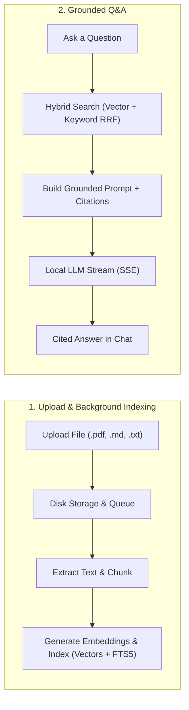

# Lexicon

**Lexicon** is a private, local-first AI document assistant. Upload PDFs, Markdown notes, or text files and ask questions in plain English—Lexicon searches your library, streams a grounded answer in real time, and links every claim back to the exact passage it came from. Everything runs on your own machine with no cloud accounts or external APIs required.

---

## At a Glance

- **Private by default** — Documents, embeddings, conversation history, and AI inference stay on local infrastructure (`SQLite` + local `Ollama`).
- **Verifiable answers, not black-box guesses** — Every response cites numbered source passages (`[1]`, `[2]`) that open a side panel showing the original document, page or section, and retrieved excerpt.
- **Instant hybrid search** — Combines meaning-based semantic search with exact keyword matching so both conceptual questions and specific terms (names, IDs, flags) surface reliably.
- **Single-app delivery** — Built as a responsive Vue 3 web workspace served directly from a .NET 10 backend, with background document indexing, live health diagnostics, and Light / Dark / System themes.

## How It Works



---

## Implemented Features

| Workspace Area | Route | Capabilities |
|---|---|---|
| **Overview Dashboard** | `/` | Corpus metrics (document count, indexed chunks, stored size), live pipeline status, recent uploads, and system health snapshot. |
| **Streaming RAG Chat** | `/chat` | Persistent multi-turn conversations, real-time Server-Sent Events (SSE) token streaming with stop/cancel, optional document-scope filtering, clickable citation chips, and a passage inspection slideover. |
| **Document Library** | `/documents` | Drag-and-drop upload (`.pdf`, `.md`, `.txt` up to 25 MB), automatic background indexing with live `Pending` → `Processing` → `Ready` / `Failed` status polling, original file download, one-click re-index, and cascade delete. |
| **Hybrid Search Workbench** | `/search` | Direct retrieval testing with document filters, configurable Top-K, fused relevance + vector/keyword score breakdowns, and query latency telemetry. |
| **System Health** | `/health` | Live diagnostics for SQLite connectivity and pending migrations, local filesystem storage, and Ollama availability—including exact `ollama pull` commands when a configured model is missing. |

---

## Architecture & Engineering Decisions

Lexicon is structured around narrow, swappable interfaces (`Controllers` → `Services` interfaces ← `Infrastructure` adapters) so domain logic stays decoupled from storage, search, and AI vendor choices.

### 1. Swappable Infrastructure via DI & Configuration
Every external dependency sits behind an interface wired by configuration (`appsettings.json`) rather than hardcoded into features:
- **AI models (`IChatClient`, `IEmbeddingGenerator<string, Embedding<float>>`)**: Consumes `Microsoft.Extensions.AI` abstractions backed by `OllamaSharp`, making it straightforward to swap Ollama for OpenAI, Azure OpenAI, or another compatible provider.
- **Persistence & search (`IVectorStore`, `IKeywordIndex`, `IRetriever`, `IDocumentStorage`, `IIngestionQueue`, `IDocumentTextExtractor`, `IChunker`, `IPromptBuilder`, `IChatService`)**: Default local implementations can be replaced independently (for example moving from SQLite to PostgreSQL/`pgvector` or local disk to object storage) without changing controllers or orchestration logic.

### 2. Hybrid Retrieval Without External Infrastructure
Dense embeddings capture meaning but often miss exact identifiers, while full-text search excels at exact terms but misses paraphrases. Lexicon runs both and merges results:
- **Vector similarity (`SqliteVectorStore`)**: Stores `float32[]` embeddings as SQLite `BLOB`s tagged with model name and dimensions, scoring candidates in-process with SIMD-accelerated `TensorPrimitives.CosineSimilarity` and a bounded `PriorityQueue`—avoiding native extension setup while scaling cleanly to local workloads.
- **Keyword search (`SqliteFts5KeywordIndex`)**: Queries an FTS5 virtual table (`unicode61`) with bounded token expansion and BM25 ranking inside the same EF Core transaction lifecycle.
- **Rank fusion (`HybridRetriever`)**: Combines vector and keyword rankings using Reciprocal Rank Fusion (RRF), normalizing disparate score scales without magic thresholds.

### 3. Concurrency, Reliability & Security
- **SQLite WAL concurrency**: An EF Core `DbConnectionInterceptor` (`SqlitePragmaConnectionInterceptor`) configures `busy_timeout = 5000`, `journal_mode = WAL`, `synchronous = NORMAL`, and `foreign_keys = ON` on every opened connection so background ingestion workers do not block concurrent chat or search reads.
- **Resilient background ingestion**: Files enqueue into a bounded-overhead `Channel<Guid>` processed in isolated DI scopes; interrupted `Pending` / `Processing` documents automatically re-enqueue on startup, and commits guard against documents deleted mid-ingestion.
- **Atomic storage & safe errors**: Uploads stream to temporary files before atomic rename under opaque GUID storage keys with path-traversal checks; unexpected runtime failures log full diagnostics server-side while returning RFC 9457 `ProblemDetails` and sanitized user-facing messages.
- **XSS-safe Markdown rendering**: The SPA parses streamed assistant output—including headings (`h1`–`h6`), GitHub Flavored Markdown tables, fenced code blocks with copy buttons, lists, blockquotes, horizontal rules, inline emphasis, and `[n]` citation chips—into an AST rendered strictly with Vue `h()` VNodes (zero `v-html`).
- **Testability by design**: Deterministic `TimeProvider` injection replaces static system clock calls across services, `IPromptBuilder` isolates token-budgeted context and history trimming as a pure module, and frontend composables (`useChat`) and clients accept injected dependencies for clean unit testing.

---

## Tech Stack

| Layer | Technologies |
|---|---|
| **Backend** | .NET 10, ASP.NET Core Web API, Entity Framework Core 10, SQLite (WAL + FTS5 + BLOB vectors), `Microsoft.Extensions.AI`, `OllamaSharp`, `PdfPig`, `System.Numerics.Tensors` |
| **Frontend** | Vue 3 (`<script setup>`), TypeScript, Vite 6, Nuxt UI v4 (`@nuxt/ui`), Tailwind CSS v4, Pinia (+ persisted state), Vue Router 4, VueUse (`@vueuse/core`) |

---

## API Reference

| Method | Endpoint | Description |
|---|---|---|
| `GET` | `/api/health` | Aggregate health (`Healthy` / `Degraded` / `Unhealthy`) across database, storage, and Ollama + model readiness. |
| `GET` | `/api/documents` | List all uploaded documents newest-first with ingestion status and chunk counts. |
| `POST` | `/api/documents` | Upload a `.pdf`, `.md`, or `.txt` file (`multipart/form-data`); returns `201 Created` and queues background indexing. |
| `GET` | `/api/documents/{documentId}` | Retrieve metadata and status for a single document. |
| `GET` | `/api/documents/{documentId}/file` | Download the original uploaded file (supports range requests). |
| `POST` | `/api/documents/{documentId}/reindex` | Re-enqueue an existing document for extraction, chunking, and embedding (`202 Accepted`). |
| `DELETE` | `/api/documents/{documentId}` | Remove a document along with its stored file, chunks, vectors, and FTS5 index rows. |
| `POST` | `/api/search` | Run hybrid vector + keyword retrieval directly and inspect fused scores. |
| `GET` | `/api/conversations` | List conversations ordered by most recently updated. |
| `POST` | `/api/conversations` | Create a new conversation. |
| `GET` | `/api/conversations/{conversationId}` | Load full conversation history with persisted message citations. |
| `DELETE` | `/api/conversations/{conversationId}` | Delete a conversation and cascade-delete its messages. |
| `POST` | `/api/conversations/{conversationId}/messages` | Persist the user turn, retrieve context passages, and stream Server-Sent Events (`citations`, `token`, `done`, `error`). |

---

## Running Locally

### Prerequisites
- [.NET 10 SDK](https://dotnet.microsoft.com/download)
- [Node.js](https://nodejs.org/) (v20+ recommended for `ClientApp`)
- [Ollama](https://ollama.com/) running locally (or on your LAN, configurable in `appsettings.Development.json`) with a chat model and embedding model matching `appsettings.json`:

```bash
ollama pull lfm3:1.7b
ollama pull nomic-embed-text:latest
```

### Development Mode (Backend + Vite HMR via SpaProxy)

```bash
dotnet run
```

ASP.NET Core starts on `http://localhost:5094` (automatically applying any pending EF Core SQLite migrations on startup) and launches the Vite dev server on `http://localhost:5173`.

### Production Single-App Build

```bash
dotnet build -c Release
```

Release builds compile `ClientApp/`, copy static assets into `wwwroot/`, and bundle the SPA directly with the ASP.NET Core host.

